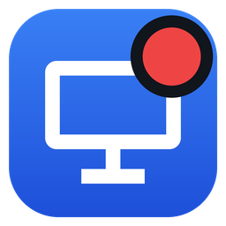
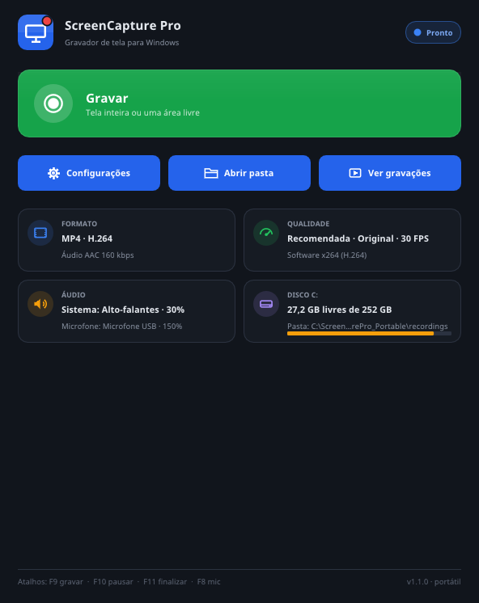
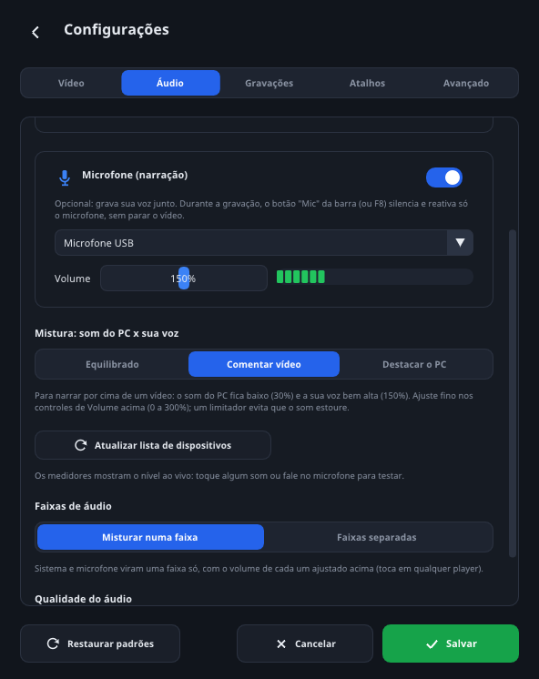
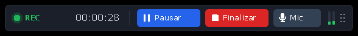

<p align="center">
  
</p>

<h1 align="center">ScreenCapture Pro</h1>

<p align="center">
  Portable screen recorder for Windows 10 and 11, with system audio, microphone and pause.<br>
  No installation, no administrator rights and no internet connection.
</p>

<p align="center">
  <a href="https://github.com/sandrolimadf1984/screencapture-pro/actions/workflows/build.yml"></a>
  
  
  <a href="LICENSE"></a>
</p>

<p align="center">
  <a href="https://github.com/sandrolimadf1984/screencapture-pro/releases/latest"><b>Download the latest version</b></a>
  &nbsp;·&nbsp; <a href="docs/TUTORIAL.md">Tutorial (Portuguese)</a>
  &nbsp;·&nbsp; <a href="README.md">Português</a>
</p>

<p align="center">
  
  &nbsp;
  
</p>
<p align="center">
  
</p>

The user interface is in Brazilian Portuguese.

## Features

- **Full screen or just an area.** Pick a monitor, draw a rectangle or click a window.
- **Pause and resume** as many times as you like: you still get a single file.
- **Control bar hidden from the video.** You see it, viewers don't.
- **System audio and microphone**, with device selection, live meters and ready-made mixes: *Equilibrado* (balanced), *Comentar vídeo* (commentary: system 30%, voice 150%) and *Destacar o PC* (system first). Volumes go from 0 to 300%, with a limiter.
- **Mic button** (or F8) mutes only your voice during a recording, without cutting the video.
- **MP4** (H.264 or H.265 + AAC) or **real AVI** (MPEG-4/Xvid, Motion JPEG or H.264 + MP3/PCM).
- **Uses the GPU** when available (NVIDIA NVENC, Intel Quick Sync or AMD AMF) and falls back to the CPU automatically.
- Resolutions from 360p to 4K plus a custom one ("2060p"), at 15, 24, 30 or 60 FPS.
- **Global hotkeys:** F9 record, F10 pause, F11 stop and F8 microphone.
- **No time limit:** it records until you pause or stop. While recording, the PC does not go to sleep and the screen does not turn off.
- **Screen lock does not ruin the recording:** on Win+L, Ctrl+Alt+Del or a Windows permission prompt (UAC), recording pauses by itself and resumes when the desktop is back.
- **Crash recovery:** if the PC shuts down mid-recording, the recording is recovered the next time the app opens.
- **Portable and private:** runs even from a USB drive, sends nothing to the internet and collects no data.

## Quick start

1. Download **ScreenCapturePro_Portable.zip** from the [releases page](https://github.com/sandrolimadf1984/screencapture-pro/releases/latest).
2. Right-click the file and choose **Extract All...**.
3. Open the folder and double-click **ScreenCapturePro.exe**.
4. Click **Gravar** (Record) and choose **Gravar tela inteira** (full screen) or **Gravação livre** (free area).

The first time, Windows may show "Windows protected your PC" because the app is not code-signed. Click **More info** and then **Run anyway**.

## How it works

- **Native C++17 (Win32)**, no .NET and no installer. The `.exe` is about 3 MB.
- **UI** built with Direct3D 11 + [Dear ImGui](https://github.com/ocornut/imgui). The area selector, control bar and border use Direct2D/DirectWrite.
- **Video** through FFmpeg 7.1, running as a child process inside a Job Object. The main capture path is DXGI Desktop Duplication (`ddagrab`), with GDI (`gdigrab`) as a fallback.
- **Audio** through WASAPI inside the app (loopback + microphone), resampled to 48 kHz and aligned to the system clock.
- **Pause without losing sync:** each segment between pauses becomes a `.nut` file. At the end, the video is concatenated without re-encoding and the audio is trimmed to exactly the same interval.
- **Hidden from capture:** `SetWindowDisplayAffinity(WDA_EXCLUDEFROMCAPTURE)` removes the bar and the app's windows from the recording, with an automatic fallback on older Windows builds.

More details (in Portuguese) in [docs/ARQUITETURA.md](docs/ARQUITETURA.md).

## Building

On Windows, with [MSYS2](https://www.msys2.org) (the "MSYS2 MINGW64" terminal):

```bash
pacman -S --needed mingw-w64-x86_64-gcc
CXX=g++ WINDRES=windres bash build.sh
```

On Linux (Ubuntu/Debian), cross-compiling:

```bash
sudo apt install g++-mingw-w64-x86-64-posix binutils-mingw-w64-x86-64
bash build.sh
```

The program is written to `build/ScreenCapturePro.exe` and needs `ffmpeg\ffmpeg.exe` next to it (the portable package already has it). **GitHub Actions** builds the `.exe` on every push. See [docs/COMPILAR.md](docs/COMPILAR.md).

## Testing

- **End-to-end tests under Wine** (Xvfb + PulseAudio) with the real FFmpeg: the script opens the app, records, pauses, mutes the microphone, stops and checks every video with `ffprobe` and a full decode ([`tools/wine_e2e.py`](tools/wine_e2e.py)).
- **Audio/video sync** measured with screen flashes and test beeps: up to about 45 ms apart, with no drift over time or after pauses.
- **Long recording:** a 3h30 session was assembled with matching video and audio durations and exact sync at the start and after 3h20.
- **Screen lock** (simulated in the test): recording pauses by itself and resumes when the desktop is back, in a single file.
- DXGI capture, WASAPI loopback, capture exclusion and GPU encoders rely on features Wine does not provide. They follow the Microsoft and FFmpeg documentation and have automatic fallbacks.

## Privacy

The app never connects to the internet: it does not send videos, images, settings or usage data. In free-area mode, only the selected area is captured.

## License and credits

The code in this repository is released under the [MIT license](LICENSE). Third-party components keep their own licenses:

- [Dear ImGui](https://github.com/ocornut/imgui), MIT
- [JSON for Modern C++ (nlohmann/json)](https://github.com/nlohmann/json), MIT
- [Noto Sans](https://fonts.google.com/noto), SIL Open Font License 1.1
- [FFmpeg](https://ffmpeg.org), GPL v3. Not part of this repository. The portable package on the [releases page](https://github.com/sandrolimadf1984/screencapture-pro/releases/latest) ships the unmodified `ffmpeg.exe` as a separate program, with its license and source information in the `licencas` folder.

Current version: **1.1.1**. See the [changelog](CHANGELOG.md) (in Portuguese).

## Author

**Sandro de Lima Pereira**: [GitHub](https://github.com/sandrolimadf1984) · [LinkedIn](https://www.linkedin.com/in/sandrolimadev)
