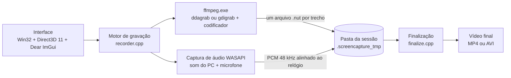

# Arquitetura do ScreenCapture Pro

Programa nativo em C++17 para Windows 10/11 de 64 bits, sem .NET, sem Python e sem DLLs extras: usa só bibliotecas que já vêm no Windows. O `.exe` tem cerca de 3 MB. A gravação de vídeo fica com o FFmpeg, que roda como um programa separado; o áudio é capturado pelo próprio programa.

## Peças principais

**Interface.** Win32 + Direct3D 11 + Dear ImGui, com tema escuro próprio, ícones desenhados em vetor e escala automática por monitor (Per-Monitor DPI v2). O seletor de área, a barra flutuante, a moldura e a contagem regressiva são janelas Win32 desenhadas com Direct2D/DirectWrite.

**Vídeo.** O FFmpeg 7.1 (`ffmpeg\ffmpeg.exe`) roda como processo filho dentro de um Job Object, para nenhum ffmpeg sobreviver ao programa.

- Captura principal: DXGI Desktop Duplication (filtro `ddagrab`), na placa de vídeo certa de cada monitor.
- Reserva automática: GDI (`gdigrab`), que lê só a área escolhida.
- Codificadores: NVIDIA NVENC, Intel Quick Sync e AMD AMF quando um teste no início confirma que funcionam; senão x264/x265 no processador. MPEG-4 (Xvid) e Motion JPEG para AVI.

**Áudio.** WASAPI dentro do programa: loopback do dispositivo de saída (o som do PC) e microfone opcional, cada um numa thread.

- Tudo é convertido para 48 kHz estéreo e gravado em PCM de 16 bits, **alinhado ao relógio do sistema**.
- Se o dispositivo padrão do Windows mudar no meio (um fone conectado, por exemplo), a captura acompanha. Se o dispositivo cair, ela reconecta sozinha.
- O "mudo" do microfone (botão Mic da barra ou F8) troca a voz por silêncio com uma rampa de 10 ms, sem parar a captura.
- Os volumes (0 a 300%) e a mistura são aplicados na montagem final, com um limitador para o som não estourar.

**Sincronia e pausa.** Cada trecho entre pausas é um ffmpeg separado, que grava um arquivo `.nut` com o horário real de cada quadro. Na finalização, o programa lê o horário do primeiro quadro e o número de quadros de cada trecho, recorta exatamente o mesmo intervalo do áudio e junta tudo num único MP4/AVI (concat + cópia do vídeo, sem recodificar). Por isso a pausa não desalinha o áudio e o resultado é um arquivo só.

**Segurança contra perdas.** Os trechos ficam numa pasta de sessão (`.screencapture_tmp`) com um `session.json`. Se o programa ou o PC cair, a sessão é oferecida para recuperação na próxima abertura.

**Gravações longas.** Não há limite de tempo. Durante a sessão o programa pede ao Windows para não suspender nem apagar a tela (`SetThreadExecutionState`). Se a tela for bloqueada ou abrir uma janela do UAC (a área de trabalho segura, onde nada pode ser capturado), a gravação pausa sozinha e volta quando `OpenInputDesktop` indicar a área de trabalho normal de novo. O limite é o disco: a gravação para quando o espaço livre chega ao necessário para montar o vídeo final, que é parecido com o tamanho da sessão. Na montagem, os trechos são lidos em fluxo, sem tempo máximo.

**Fora do vídeo.** A barra flutuante, a moldura, a contagem e a janela principal usam `SetWindowDisplayAffinity(WDA_EXCLUDEFROMCAPTURE)` (Windows 10 versão 2004 ou mais novo). Em Windows antigos há um plano B automático: a barra vai para fora da área gravada, para outro monitor ou fica escondida (aí o controle é pelos atalhos e pelo ícone perto do relógio).

**Configurações e logs.** Configurações em JSON (`config\settings.json` no modo portátil) e logs diários em `logs\`. Nenhuma conexão de rede.

## Mapa dos arquivos (pasta `src`)

| Arquivo | O que faz |
| --- | --- |
| `branding.h` | Nome, versão e autor. Para trocar o nome do programa, mude só aqui |
| `main.cpp` | Entrada, uma cópia aberta por vez, registro de falhas graves |
| `app.*` | Janela principal, fluxo de gravação, ícone da bandeja e atalhos |
| `ui_pages.cpp` | Telas: início, escolha do monitor, configurações e gravações |
| `ui.*` | Tema, fontes, ícones e componentes visuais |
| `overlay.*` | Seletor de área (gravação livre) |
| `controlbar.*` | Barra flutuante, moldura e contagem regressiva |
| `recorder.*` | Motor de gravação: trechos, pausa e recuperação de erros |
| `ffmpeg.*` | Linhas de comando do FFmpeg e detecção dos codificadores |
| `audio.*` | Captura WASAPI alinhada ao relógio, mudo do microfone |
| `finalize.*` | Montagem do vídeo final: concat, áudio recortado e mistura |
| `session.*` | Pasta e arquivo de sessão (recuperação) |
| `monitors.*` | Monitores, escala e placa de vídeo de cada um |
| `settings.*` | Opções e leitura/gravação do JSON |
| `paths.*` | Modo portátil e pastas |
| `library.*` | Lista de gravações |
| `hotkeys.*` | Atalhos globais |
| `tray.*` | Ícone perto do relógio e notificações |
| `process.*` | Processos filhos (pipes + Job Object) |
| `log.*` | Logs diários |
| `d2d.*`, `win_util.*`, `common.*` | Utilitários de Direct2D, Windows e texto |
| `resources.rc`, `app.manifest` | Ícone, versão do .exe e manifesto (DPI, Windows 10/11) |
