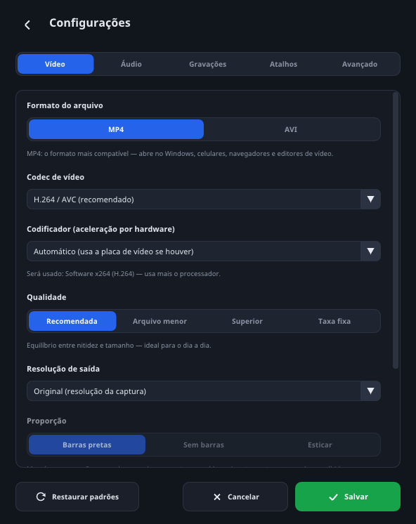
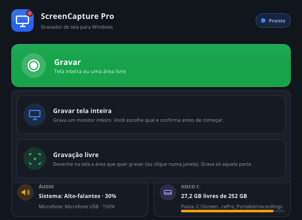
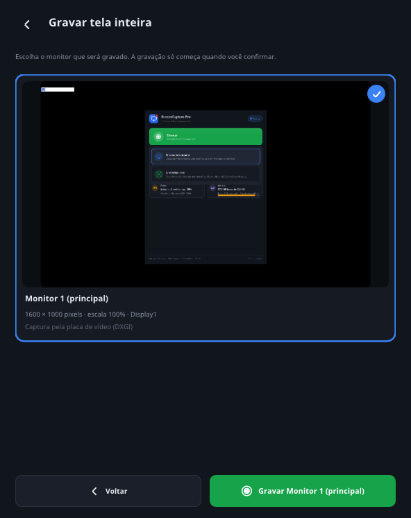
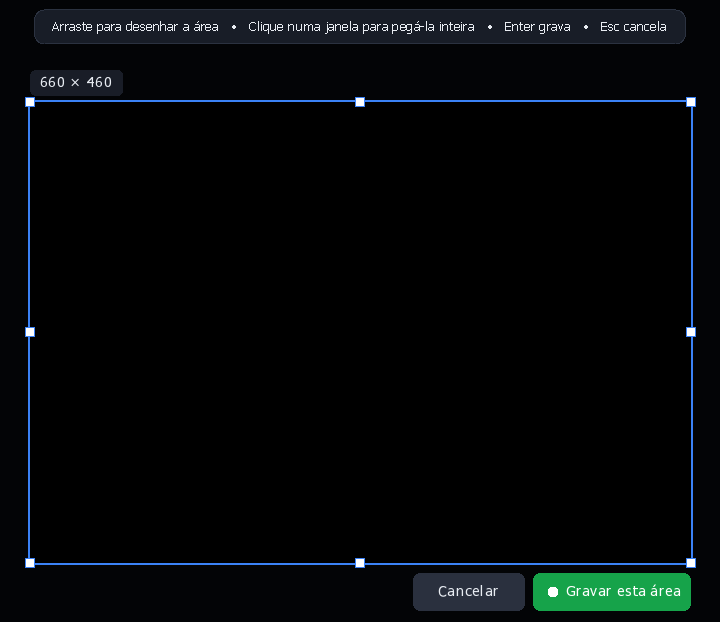
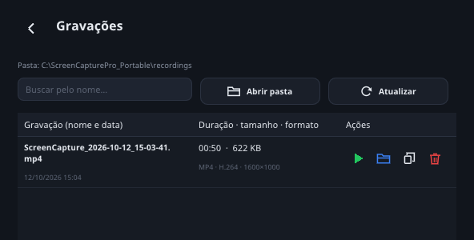

# Tutorial do ScreenCapture Pro

Guia da versão 1.1.1. A configuração que vem de fábrica já é a melhor para quase tudo: MP4 com H.264, codificador Automático, qualidade Recomendada, resolução Original e 30 FPS. Para gravar tutoriais com a sua voz, você só precisa ligar o microfone e escolher a mistura de volumes (Equilibrado para tutorial, Comentar vídeo para comentar um vídeo).

Primeira vez? Leia nesta ordem: [Antes de começar](#antes-de-começar), [Melhor configuração para gravar](#melhor-configuração-para-gravar) e [Sua primeira gravação](#sua-primeira-gravação). As outras seções servem de consulta.

**Sumário:** [Antes de começar](#antes-de-começar) · [Tela principal](#tela-principal) · [Melhor configuração](#melhor-configuração-para-gravar) · [Primeira gravação](#sua-primeira-gravação) · [Durante a gravação](#durante-a-gravação) · [Gravar com a sua voz](#gravar-com-a-sua-voz) · [Seus vídeos](#seus-vídeos) · [Todas as configurações](#todas-as-configurações-aba-por-aba) · [Problemas comuns](#problemas-comuns) · [Atualizar](#atualizar-para-uma-versão-nova)

## Antes de começar

Você precisa de Windows 10 ou 11 (64 bits) e uns 200 MB livres, mais o espaço dos vídeos. Não precisa instalar nada nem ter internet: o componente que monta os vídeos (FFmpeg) já vem na pasta. O programa nunca envia vídeos nem dados para a internet.

1. Baixe o arquivo **ScreenCapturePro_Portable.zip** na [página de versões](https://github.com/sandrolimadf1984/screencapture-pro/releases/latest).
2. No computador, clique com o botão direito no arquivo e escolha **Extrair tudo...**.
3. Escolha onde a pasta vai ficar (por exemplo, Documentos ou Área de Trabalho) e clique em **Extrair**. Não abra o programa de dentro do .zip: ele precisa da pasta extraída.
4. Abra a pasta **ScreenCapturePro_Portable** e dê dois cliques em **ScreenCapturePro.exe**.
5. Se o Windows mostrar "O Windows protegeu o computador", clique em **Mais informações** e depois em **Executar assim mesmo**. Isso acontece com qualquer programa novo sem assinatura digital.
6. Para achar o programa fácil depois, crie um atalho: botão direito em **ScreenCapturePro.exe** > **Enviar para** > **Área de trabalho (criar atalho)**. No Windows 11, clique antes em **Mostrar mais opções**.

| Item da pasta | Para que serve |
| --- | --- |
| ScreenCapturePro.exe | O programa |
| recordings | Seus vídeos (pasta padrão) |
| config | Suas configurações (arquivo settings.json) |
| ffmpeg | Componente que monta os vídeos. Não apague |
| logs | Registros técnicos, úteis se der algum problema |
| licencas | Licenças dos componentes usados |
| README.txt | Manual resumido |

Para levar para outro computador, copie a pasta inteira (não só o .exe). Para desinstalar, feche o programa e apague a pasta: nada fica no Registro do Windows.

## Tela principal

A janela tem o botão verde **Gravar**, três botões azuis e quatro quadros que resumem a configuração atual. Confira os quadros antes de gravar: se estiverem certos, a gravação vai sair como você quer.

*Tela principal, com o microfone ligado e a mistura Comentar vídeo. Os nomes dos aparelhos de som e do codificador mudam conforme o PC.*

| Item | O que faz |
| --- | --- |
| Gravar (verde) | Abre o menu com **Gravar tela inteira** e **Gravação livre** |
| Configurações | Abre os ajustes, divididos nas abas Vídeo, Áudio, Gravações, Atalhos e Avançado |
| Abrir pasta | Abre a pasta onde os vídeos são salvos |
| Ver gravações | Lista os vídeos gravados, com botões para abrir, achar na pasta, copiar o caminho e excluir |
| Quadro FORMATO | Formato e codec (ex.: MP4 · H.264) e o tipo de áudio (ex.: Áudio AAC 160 kbps) |
| Quadro QUALIDADE | Qualidade, resolução e FPS. Embaixo, qual codificador será usado (ex.: Hardware: AMD AMF) |
| Quadro ÁUDIO | Qual som do sistema e qual microfone serão gravados, com a % quando o volume não está em 100% |
| Quadro DISCO | Espaço livre no disco e a pasta dos vídeos |
| Etiqueta no canto superior direito | Estado do programa: Pronto, Gravando, Pausado, Processando… ou Concluído |
| Rodapé | Lembra os atalhos (F9 gravar · F10 pausar · F11 finalizar · F8 mic) e mostra a versão |

Avisos aparecem em faixas coloridas embaixo dos quadros, como "Gravação salva" ou um problema no áudio. Clique no X para fechar cada um.

O programa também tem um ícone perto do relógio do Windows. Clique nele com o botão direito para gravar, abrir a pasta, ver as gravações ou sair. No Windows 11, se ele não aparecer, clique na setinha **^** ao lado do relógio.

## Melhor configuração para gravar

Quase tudo já vem certo de fábrica. Para tutoriais com narração, você só muda duas coisas na aba Áudio: liga o microfone e escolhe a mistura. As tabelas mostram o que deixar em cada aba e por quê.

### Como aplicar (uma vez só)

1. Clique em **Configurações**. As abas ficam no topo: Vídeo, Áudio, Gravações, Atalhos e Avançado.
2. Confira cada aba usando as tabelas abaixo.
3. Na aba **Avançado**, clique em **Testar por 5 segundos**. O resultado deve dizer "APROVADO: seu computador dá conta desta configuração."
4. Clique em **Salvar** (botão verde, embaixo à direita). O programa guarda tudo para as próximas vezes.

Se o teste mostrar "ATENÇÃO: o computador não acompanhou", baixe a resolução (1080p ou 720p), deixe o FPS em 30 ou use a qualidade Arquivo menor. Depois teste de novo.

### Aba Vídeo

| Opção | Deixe assim | Por quê |
| --- | --- | --- |
| Formato do arquivo | MP4 | Abre em tudo: Windows, celular, WhatsApp, YouTube e editores de vídeo |
| Codec de vídeo | H.264 / AVC (recomendado) | O mais compatível. O H.265 gera arquivos menores, mas nem todo player abre |
| Codificador | Automático (usa a placa de vídeo se houver) | Usa a placa de vídeo (AMD, NVIDIA ou Intel) e deixa o PC leve enquanto grava |
| Qualidade | Recomendada | Equilíbrio entre nitidez e tamanho. Use Superior se o tutorial tiver letra pequena (planilhas, código) |
| Resolução de saída | Original (resolução da captura) | Grava exatamente os pixels da tela, com o texto mais nítido |
| Quadros por segundo (FPS) | 30 | Suficiente para tutoriais e comentários. Use 60 para jogos |
| Mostrar o cursor do mouse no vídeo | Ligado | Quem assiste vê onde você clica |

*Aba Vídeo com a configuração recomendada. A linha "Será usado" mostra o codificador do PC (aqui, um PC de teste sem placa de vídeo).*

### Aba Áudio

| Opção | Deixe assim | Por quê |
| --- | --- | --- |
| Áudio do sistema | Ligado, em Padrão do Windows | Grava o som do PC e acompanha sozinho se você trocar de fone ou caixa de som |
| Microfone (narração) | Ligado, com o seu microfone escolhido na lista | Se o PC tiver mais de um microfone (webcam, fone, notebook), escolher pelo nome evita gravar com o errado |
| Mistura: som do PC x sua voz | Equilibrado (tutorial) ou Comentar vídeo | A mistura ajusta os dois volumes de uma vez. Comentar vídeo deixa o som do PC em 30% e a sua voz em 150% |
| Faixas de áudio | Misturar numa faixa | Toca em qualquer player. Faixas separadas é só para quem vai editar depois |
| Qualidade do áudio | 160 kbps (recomendado) | Ótimo para voz e música |

### Aba Gravações

| Opção | Deixe assim | Por quê |
| --- | --- | --- |
| Pasta de destino dos vídeos | A padrão (recordings) | Fica junto do programa. Se o programa estiver num pendrive, troque por uma pasta do PC |
| Nome dos arquivos | ScreenCapture_{data}_{hora} | Cada vídeo ganha data e hora no nome e nunca apaga outro |
| Depois de finalizar uma gravação | Só mostrar uma notificação | É só clicar na notificação "Vídeo pronto!" para abrir a pasta |
| Contagem regressiva antes de gravar | 3 s | Dá tempo de respirar antes de começar a falar |
| Minimizar esta janela ao começar a gravar | Ligado | A janela do programa sai da frente |
| Mostrar moldura verde em volta da área | Ligado | Mostra o que está sendo gravado e não aparece no vídeo |

### Abas Atalhos e Avançado

| Opção | Deixe assim | Por quê |
| --- | --- | --- |
| Atalhos | F9, F10, F11 e F8 | Funcionam mesmo com outro programa na frente |
| O que o F9 faz | Abrir o menu Gravar (escolher o modo) | Você escolhe na hora entre tela inteira e área |
| Método de captura | Automático (recomendado) | Usa a placa de vídeo e troca sozinho para o modo de compatibilidade se precisar |
| Modo portátil | Ligado | Tudo fica dentro da pasta do programa |

### Ajustes para cada tipo de vídeo

| Vou gravar | Resolução e FPS | Qualidade | Mistura |
| --- | --- | --- | --- |
| Tutorial com narração | Original · 30 FPS | Recomendada | Equilibrado |
| Comentário de um vídeo | Original · 30 FPS | Recomendada | Comentar vídeo |
| Jogo com narração | Original ou 1080p · 60 FPS | Recomendada | Equilibrado (ou Comentar vídeo, se o jogo abafar a voz) |
| Vídeo para mandar no WhatsApp | 720p HD · 30 FPS | Arquivo menor | Conforme o vídeo |
| Vídeo para editar depois | Original · 30 ou 60 FPS | Superior | Equilibrado, com Faixas separadas |

Nos quatro primeiros casos, deixe as faixas em Misturar numa faixa.

Mudou algo e quer voltar ao início? Clique em **Restaurar padrões** e depois em **Salvar**. A pasta escolhida é mantida, mas o microfone volta a ficar desligado: ligue de novo na aba Áudio.

## Sua primeira gravação

Toda gravação começa no botão verde **Gravar** (ou na tecla F9). Você escolhe entre gravar a tela inteira ou só um pedaço dela.

### Gravar a tela inteira

1. Clique em **Gravar** e escolha **Gravar tela inteira**.
2. Aparece uma miniatura de cada monitor. Clique no que quer gravar (com um monitor só, ele já vem marcado).
3. Clique no botão verde **Gravar Monitor 1 (principal)**. O nome muda conforme o monitor escolhido. Dois cliques na miniatura fazem o mesmo.
4. Aparece a contagem "A gravação começa em" 3, 2, 1. Para desistir, aperte **Esc**.
5. A gravação começa, a janela do programa é minimizada e a barra de controle aparece no canto superior esquerdo da tela.

### Gravar só um pedaço da tela (Gravação livre)

1. Clique em **Gravar** e escolha **Gravação livre**.
2. A tela escurece. Clique e arraste para desenhar um retângulo em volta do que quer gravar. O tamanho em pixels aparece em cima dele.
3. Quer gravar uma janela inteira? Em vez de arrastar, só clique em cima dela.
4. Ajuste se precisar: arraste por dentro para mover, puxe as bordas para mudar o tamanho ou use as setas do teclado (Shift + seta move mais rápido).
5. Confirme com o botão **Gravar esta área**, com a tecla **Enter** ou com dois cliques dentro da área. Para cancelar, use **Cancelar** ou **Esc**.
6. Depois da contagem, a gravação começa sozinha. Uma moldura verde fina mostra a área; ela fica do lado de fora e não aparece no vídeo.

*Gravação livre: o tamanho aparece em cima e os botões embaixo. No PC de verdade, o que fica dentro do retângulo aparece normalmente.*

A área precisa ficar dentro de um monitor só e ter pelo menos 64 × 64 pixels. O botão direito do mouse apaga a área desenhada para você começar de novo. Só o que está dentro da área é gravado: uma janela com senha ao lado não entra no vídeo.

### Terminar e assistir

1. Clique em **Finalizar** na barra (ou aperte **F11**).
2. O programa monta o vídeo e mostra "Processando o vídeo…" com a porcentagem. Espere terminar.
3. Aparece a notificação **Vídeo pronto!** perto do relógio. Clique nela para abrir a pasta.
4. Na janela do programa aparece "Gravação salva", com o nome, a duração e o tamanho, e os botões **Abrir vídeo** e **Mostrar na pasta**.

Na primeira vez, grave uns 30 segundos e assista ao resultado antes de gravar algo longo.

## Durante a gravação

A barra flutuante controla tudo e não aparece no vídeo: você vê, quem assiste não. Ela fica sempre por cima das outras janelas e pode ser arrastada por qualquer parte que não seja um botão.

| Parte da barra | O que faz |
| --- | --- |
| ● REC e o tempo | Mostram que está gravando e há quanto tempo. Muda para PAUSADO na pausa e SALVANDO ao finalizar |
| Pausar / Continuar | Pausa a gravação e o cronômetro. Ao continuar, tudo vai para o mesmo arquivo, sem vídeo picado |
| Finalizar | Encerra e monta o vídeo |
| Mic / Mudo | Silencia só a sua voz. O vídeo e o som do PC continuam. Só aparece com o microfone ligado |
| Risquinhos à direita | Nível do som do PC e do microfone. O do microfone fica laranja quando está mudo |

### Atalhos de teclado

| Tecla | O que faz | Quando funciona |
| --- | --- | --- |
| F9 | Abre o menu Gravar | Com o programa parado, esperando |
| F10 | Pausa e continua | Durante a gravação |
| F11 | Finaliza | Durante a gravação |
| F8 | Silencia e reativa o microfone | Durante a gravação, com o microfone ligado |
| Esc | Cancela a seleção de área ou a contagem | Na seleção de área e na contagem |

Os atalhos funcionam mesmo com outro programa na frente. Em muitos notebooks, as teclas F mudam volume ou brilho: se o atalho não funcionar, aperte junto com a tecla **Fn** (ex.: Fn + F9) ou troque o atalho em Configurações > Atalhos.

### Outros jeitos de controlar

- **Janela do programa:** fica minimizada na barra de tarefas; clique no ícone dela para abrir. Mostra o cronômetro grande, o que está sendo gravado, os níveis de som e os botões **Pausar**, **Silenciar mic** e **Finalizar**. Ela também não aparece no vídeo.
- **Ícone perto do relógio:** botão direito > **Pausar**, **Finalizar gravação** ou **Silenciar o microfone**.

### Desistir de uma gravação

Abra a janela do programa pela barra de tarefas, clique em **Descartar esta gravação…** e confirme em **Descartar**. Tudo o que foi gravado nessa vez é apagado e nenhum vídeo é salvo. O botão **Continuar** volta sem apagar nada.

Se você fechar o programa no meio da gravação, ele pergunta antes. **Salvar e sair** finaliza, salva o vídeo e só depois fecha.

Mudanças nas Configurações feitas durante uma gravação só valem a partir da próxima.

### Gravações longas

Não há limite de tempo: o programa grava até você pausar ou finalizar, mesmo que sejam horas.

- Enquanto a gravação estiver aberta, o PC não entra em suspensão e a tela não apaga sozinha, mesmo sem você mexer no mouse.
- Se a tela do Windows bloquear (Win+L, Ctrl+Alt+Del) ou aparecer uma janela de permissão do Windows, a gravação pausa sozinha. Quando a tela voltar, ela continua no mesmo arquivo e aparece um aviso. O tempo bloqueado não entra no vídeo.
- O único limite é o espaço em disco: para montar o vídeo no final, o programa precisa de espaço livre parecido com o que a gravação já ocupa. Ele avisa antes e finaliza sozinho a tempo de salvar o vídeo inteiro.
- Se você mesmo suspender o PC (ou fechar a tampa do notebook), o programa finaliza e salva o que foi gravado até ali.

## Gravar com a sua voz

Qualquer microfone que o Windows reconheça funciona: USB, de fone de ouvido, da webcam, do notebook ou Bluetooth. Você configura uma vez e o programa guarda.

### Ligar o microfone

1. Clique em **Configurações** e depois na aba **Áudio**.
2. Na caixa **Microfone (narração)**, clique na chavinha à direita para ligar.
3. Na lista, escolha o seu microfone (ou deixe **Padrão do Windows**). Plugou o microfone com o programa aberto? Clique em **Atualizar lista de dispositivos**.
4. Fale alguma coisa: o medidor ao lado de **Volume** tem que mexer. Se aparecer uma mensagem em vermelho, veja [Problemas comuns](#problemas-comuns).
5. Em **Mistura: som do PC x sua voz**, escolha a mistura (tabela abaixo).
6. Clique em **Salvar**.

*Aba Áudio: microfone ligado e mistura Comentar vídeo (som do PC em 30%, voz em 150%).*

### Mistura de volumes

A mistura só aparece quando o som do sistema e o microfone estão ligados.

| Botão | Som do PC | Sua voz | Quando usar |
| --- | --- | --- | --- |
| Equilibrado | 100% | 100% | Tutoriais e explicações |
| Comentar vídeo | 30% | 150% | Falar por cima de um vídeo, live ou jogo |
| Destacar o PC | 100% | 60% | Quando o som do PC é o principal e você fala pouco |

Quer outro equilíbrio? Mexa nos dois controles de **Volume** (de 0% a 300%). O programa mostra "Personalizado" com os valores escolhidos. Um limitador automático impede que o som distorça quando você aumenta muito.

### Silenciar o microfone no meio da gravação

Para tossir, atender alguém ou falar com quem chegou perto:

1. Clique em **Mic** na barra. Ele fica laranja e escrito **Mudo**: sua voz para de ser gravada.
2. Quando quiser voltar a falar, clique de novo.

Também dá para usar a tecla **F8**, o botão **Silenciar mic** da janela ou o ícone perto do relógio > **Silenciar o microfone**. Enquanto está mudo, o vídeo e o som do PC continuam gravando, e não fica estalo ao ligar ou desligar.

### Dicas para a voz sair boa

- Use fone de ouvido. Com caixa de som, o microfone pega o som do PC de novo e o vídeo fica com eco.
- Fale perto do microfone, num lugar sem barulho, e sempre na mesma distância.
- O volume do próprio vídeo (o controle de volume do YouTube, por exemplo) também entra na gravação. Ao comentar, deixe-o num volume médio.
- Antes de um vídeo longo, grave 30 segundos e escute. Se a voz estiver baixa, suba o Volume do microfone.
- **Faixas separadas** grava o som do PC e a voz em duas faixas, para ajustar num editor de vídeo. Alguns players tocam só a primeira faixa, então só use se for editar.

## Seus vídeos

Os vídeos ficam na pasta **recordings**, dentro da pasta do programa. O botão **Abrir pasta** da tela principal abre essa pasta direto.

### Tela Ver gravações

Clique em **Ver gravações** para ver a lista dos seus vídeos. Cada linha mostra o nome, a data e a hora, a duração, o tamanho, o formato e a resolução.

| Botão | O que faz |
| --- | --- |
| Buscar pelo nome… | Filtra a lista enquanto você digita |
| Abrir pasta | Abre a pasta dos vídeos |
| Atualizar | Relê a pasta (útil se você mexeu nos arquivos por fora) |
| ▶ (verde) | Abre o vídeo no player |
| Pasta (azul) | Mostra o arquivo na pasta, já selecionado |
| Copiar | Copia o caminho do arquivo, para colar onde precisar |
| Lixeira (vermelha) | Exclui o vídeo. Pede confirmação e manda para a Lixeira do Windows |

Em pendrive ou HD externo, o Windows exclui direto, sem passar pela Lixeira.

### Nome dos arquivos

O padrão é assim: **ScreenCapture_2026-10-12_15-30-00.mp4**. Para mudar, vá em Configurações > Gravações > **Nome dos arquivos** e use estes códigos:

| Código | Vira |
| --- | --- |
| `{data}` | 2026-10-12 |
| `{hora}` | 15-30-00 |
| `{ano}` `{mes}` `{dia}` | 2026 10 12 |
| `{modo}` | TelaInteira ou Area |
| `{monitor}` | Monitor1 |

Exemplo: **Tutorial_{data}_{hora}** vira Tutorial_2026-10-12_15-30-00.mp4. Embaixo do campo, o programa mostra como o nome vai ficar. Se já existir um arquivo com o mesmo nome, ele acrescenta (2), (3)… e nunca apaga nada.

### Trocar a pasta dos vídeos

1. Vá em Configurações > **Gravações**.
2. Em **Pasta de destino dos vídeos**, clique em **Alterar…** e escolha a pasta.
3. Clique em **Salvar**.

O botão **Usar a padrão** volta para a pasta recordings. O espaço livre do disco aparece embaixo: em 1080p, cada minuto ocupa de uns 10 MB (tela quase parada) a mais de 100 MB (jogos e vídeos).

## Todas as configurações, aba por aba

Tudo o que você muda só vale depois de clicar em **Salvar**, e fica guardado para as próximas vezes. No rodapé das Configurações ainda há **Cancelar** (sai sem salvar) e **Restaurar padrões** (volta tudo ao de fábrica, menos a pasta escolhida).

### Vídeo

| Opção | Escolhas | O que significa |
| --- | --- | --- |
| Formato do arquivo | MP4 ou AVI | MP4 é o mais compatível. AVI é para programas e aparelhos antigos |
| Codec de vídeo (MP4) | H.264 / AVC ou H.265 / HEVC | O H.265 gera arquivos cerca de 40% menores, mas o player do Windows pode pedir a "Extensão de Vídeo HEVC" |
| Codec de vídeo (AVI) | MPEG-4 Parte 2 (Xvid), Motion JPEG ou H.264 | Motion JPEG é o mais compatível e fácil de editar, mas gera arquivos bem maiores |
| Codificador | Automático, Software (processador), NVIDIA NVENC, Intel Quick Sync ou AMD AMF | Quem comprime o vídeo. A placa de vídeo deixa o PC mais leve. "Não detectado" aparece quando o PC não tem aquela placa. Embaixo, o programa diz qual será usado |
| Qualidade | Recomendada, Arquivo menor, Superior ou Taxa fixa | Arquivo menor serve para WhatsApp e e-mail. Superior dá a máxima nitidez. Taxa fixa deixa você escolher os kbps (1080p a 30 FPS: de 6.000 a 10.000 kbps) |
| Resolução de saída | Original, 360p, 480p, 720p HD, 1080p Full HD, 2060p personalizada ou 4K UHD | Original grava do tamanho da tela. As outras redimensionam. Na 2060p você digita largura e altura (padrão 3662 × 2060) |
| Proporção | Barras pretas, Sem barras ou Esticar | Só vale fora do Original. Barras pretas nunca deforma a imagem. Esticar pode deformar |
| Quadros por segundo (FPS) | 15, 24, 30 ou 60 | 30 serve para quase tudo. 60 deixa jogos e rolagens mais fluidos, mas pesa mais |
| Mostrar o cursor do mouse no vídeo | Ligado ou desligado | Desligue se não quiser a setinha no vídeo |

Se a área gravada for menor que a resolução escolhida, a imagem é ampliada: o arquivo fica maior, mas não ganha detalhes.

### Áudio

| Opção | Escolhas | O que significa |
| --- | --- | --- |
| Áudio do sistema | Liga/desliga, dispositivo, Volume de 0 a 300% e medidor | Tudo que toca no PC: vídeos, navegador, chamadas, jogos e avisos do Windows |
| Microfone (narração) | Liga/desliga, dispositivo, Volume de 0 a 300% e medidor | A sua voz. Ligado, faz aparecer o botão Mic na barra |
| Mistura: som do PC x sua voz | Equilibrado, Comentar vídeo ou Destacar o PC | Ajusta os dois volumes de uma vez. Aparece com os dois ligados |
| Atualizar lista de dispositivos | Botão | Use depois de plugar um microfone, fone ou caixa de som |
| Faixas de áudio | Misturar numa faixa ou Faixas separadas | Separadas: faixa 1 = sistema, faixa 2 = microfone. Alguns players tocam só a primeira |
| Qualidade do áudio (MP4) | De 96 a 320 kbps | 160 kbps é o recomendado |
| Qualidade do áudio (AVI) | MP3 (128 a 320 kbps) ou PCM | PCM é sem compressão (cerca de 11 MB por minuto) |

Os medidores mostram o som ao vivo enquanto esta aba está aberta: toque um som ou fale para testar. Para gravar sem som nenhum, desligue o sistema e o microfone.

### Gravações

| Opção | Escolhas | O que significa |
| --- | --- | --- |
| Pasta de destino dos vídeos | Alterar…, Abrir ou Usar a padrão | Onde os vídeos são salvos. Mostra o espaço livre do disco |
| Nome dos arquivos | Texto com códigos | Veja [Nome dos arquivos](#nome-dos-arquivos) |
| Depois de finalizar uma gravação | Só mostrar uma notificação, Abrir a pasta da gravação, Abrir o vídeo no player, Mostrar a lista de gravações ou Não fazer nada | O que acontece quando o vídeo fica pronto. A notificação "Vídeo pronto!" aparece sempre |
| Contagem regressiva antes de gravar | Não, 3 s, 5 s ou 10 s | Tempo para se preparar. Esc cancela durante a contagem |
| Minimizar esta janela ao começar a gravar | Ligado ou desligado | Tira a janela do programa da frente |
| Mostrar moldura verde em volta da área | Ligado ou desligado | Só na Gravação livre. Fica do lado de fora da área e não aparece no vídeo |

### Atalhos

| Opção | Padrão | O que significa |
| --- | --- | --- |
| Iniciar gravação | F9 | Escolha também o que ele faz: abrir o menu Gravar, gravar a tela inteira do monitor onde está o mouse ou ir direto para a Gravação livre |
| Pausar / continuar | F10 | Só durante a gravação |
| Finalizar gravação | F11 | Só durante a gravação |
| Silenciar / reativar o microfone | F8 | Só durante a gravação, com o microfone ligado |
| Cancelar a seleção de área | Esc | Fixo. Também cancela a contagem regressiva |

Para trocar um atalho:

1. Clique no botão com a tecla atual. Ele mostra "Pressione a combinação…".
2. Aperte a nova tecla ou combinação (ex.: Ctrl + Shift + R). Esc cancela a troca.
3. Clique em **Salvar**.

A chavinha ao lado liga ou desliga cada atalho. O programa não deixa salvar duas funções com a mesma tecla. Se outro programa já usa a tecla, aparece "Não registrado" em vermelho: escolha outra.

### Avançado

| Opção | Escolhas | O que significa |
| --- | --- | --- |
| Método de captura | Automático, DXGI ou GDI | DXGI usa a placa de vídeo (mais leve). GDI é o modo de compatibilidade (mais pesado). Use GDI se o vídeo sair preto ou travado |
| Modo portátil | Ligado ou desligado | Ligado: configurações e logs dentro da pasta do programa. Desligado: vão para %APPDATA%\ScreenCapturePro e os vídeos para a pasta Vídeos do Windows, na subpasta ScreenCapture Pro |
| Teste de desempenho | Testar por 5 segundos | Grava 5 segundos sem salvar e diz se o PC aguenta: APROVADO ou ATENÇÃO |
| Diagnóstico | Informações do PC | Versão do Windows, se a barra fica fora do vídeo, versão do FFmpeg, placas de vídeo e monitores |
| Abrir pasta de logs e Abrir log de hoje | Botões | Abrem os registros técnicos, úteis para pedir ajuda |

## Problemas comuns

Quase todo problema tem um aviso na tela explicando o motivo. Se não tiver, procure na tabela.

| Problema | O que fazer |
| --- | --- |
| "O Windows protegeu o computador" ao abrir | Clique em **Mais informações** > **Executar assim mesmo** |
| "Componente de vídeo ausente" ou "Extraia o programa antes de usar" | Extraia o .zip inteiro e abra o .exe de dentro da pasta extraída |
| Vídeo sem o som do PC | Em Configurações > Áudio, confira se Áudio do sistema está ligado e se o medidor mexe quando toca um som. Deixe em Padrão do Windows. Com o som do Windows no mudo, a gravação pode ficar sem o som do PC |
| Microfone não grava ou medidor parado | Configurações do Windows > Privacidade e segurança > Microfone > ative "Permitir que aplicativos da área de trabalho acessem o microfone". Depois clique em Atualizar lista de dispositivos |
| Eco ou som repetido | Use fone de ouvido em vez de caixa de som |
| Voz baixa ou vídeo alto demais | Use a mistura Comentar vídeo ou suba o Volume do microfone |
| Atalho não funciona | Em notebook, tente com a tecla Fn junto. Se outro programa usa a tecla, troque em Configurações > Atalhos |
| Vídeo preto, travado ou do monitor errado | Configurações > Avançado > Método de captura > **GDI — compatibilidade** |
| Vídeo com quadros repetidos ou aviso de que não está gravando em tempo real | Baixe a resolução ou o FPS, ou use Arquivo menor. Confira com Testar por 5 segundos |
| Vídeo H.265 não abre | Instale a "Extensão de Vídeo HEVC" da Microsoft Store, use o VLC ou grave em H.264 |
| O PC desligou ou o programa fechou no meio | Abra o programa de novo. Ele mostra "Gravação interrompida encontrada": clique em **Recuperar** |
| Pouco espaço no disco | Com menos de 500 MB livres a gravação não começa. Durante a gravação, ele avisa quando o espaço fica curto e finaliza sozinho a tempo de montar o vídeo. Libere espaço ou troque a pasta |
| Gravação longa em pendrive | Pendrive em FAT32 não aceita arquivo acima de 4 GB (cerca de 1 hora em 1080p). Grave numa pasta do PC |
| A barra aparece no vídeo | Acontece no Windows 10 anterior à versão 2004. Confira em Configurações > Avançado > Diagnóstico. O programa tenta colocar a barra fora da área gravada |

Para pedir ajuda a alguém, mande o arquivo do dia que fica na pasta **logs** (atalho: Configurações > Avançado > **Abrir pasta de logs**). Ele tem só o registro técnico, nada dos seus vídeos.

## Atualizar para uma versão nova

Cada versão nova vem numa pasta nova. Você só precisa levar as configurações e os vídeos da pasta antiga.

1. Extraia o .zip novo numa pasta nova (não por cima da antiga).
2. Na pasta antiga, abra **config** e copie o arquivo **settings.json**. Cole na pasta **config** da versão nova e aceite substituir.
3. Mova os seus vídeos da pasta **recordings** antiga para a **recordings** nova (ou deixe onde estão).
4. Abra o **ScreenCapturePro.exe** da pasta nova. O rodapé da janela mostra a versão (ex.: **v1.1.1 · portátil**).
5. Está tudo certo? Pode apagar a pasta antiga.
